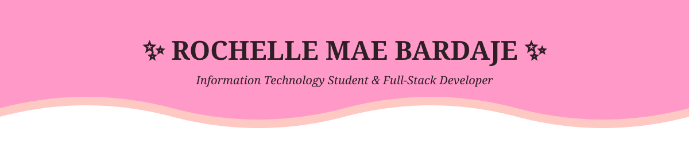

<!-- ✨ TOP WAVING BANNER ✨ -->

  

<!-- 💬 TYPING HEADER -->

  

<!-- 💌 CONTACT & SOCIAL BADGES -->

  
  
  
   
  
  
  

 

<!-- 🌸 ABOUT ME -->

  

<table align="center" width="100%">
  <tr>
    <td align="center">
       
      <i>
        Hello! I'm <b>Chelle</b>, an Information Technology student and full-stack developer 
        who loves turning complex ideas into clean, thoughtful software.  
        I build web and desktop applications with <b>robust architecture</b> and <b>soft, intuitive UI/UX</b>, 
        from document tracking platforms to facial-recognition voting systems 
        and hand-tracking projects powered by Arduino and computer vision.  
        💗 I believe great software can be both <b>powerful</b> and <b>beautiful</b>.
      </i>
        
    </td>
  </tr>
</table>

 

<!-- 💻 TECH ECOSYSTEM -->

  

**Languages & Frameworks** 

 

**Databases** 

**Tools & Hardware** 

 

 

<!-- 🎀 FEATURED PROJECTS -->

  

<table align="center" width="100%">
  <tr>
    <td width="50%" align="center" valign="top">
       
      
      
      
      
    </td>
    <td width="50%" align="center" valign="top">
       
      
      
      
    </td>
  </tr>
  <tr>
    <td width="50%" align="center" valign="top">
       
      
      
      
    </td>
    <td width="50%" align="center" valign="top">
       
      
      
      
    </td>
  </tr>
</table>

 

<!-- 📊 ACTIVITY DASHBOARD -->

  

  

 

  
  

 

<!-- 🌊 FOOTER -->

  

